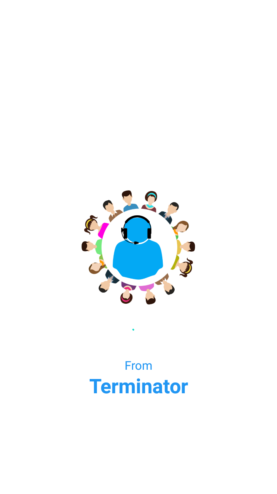
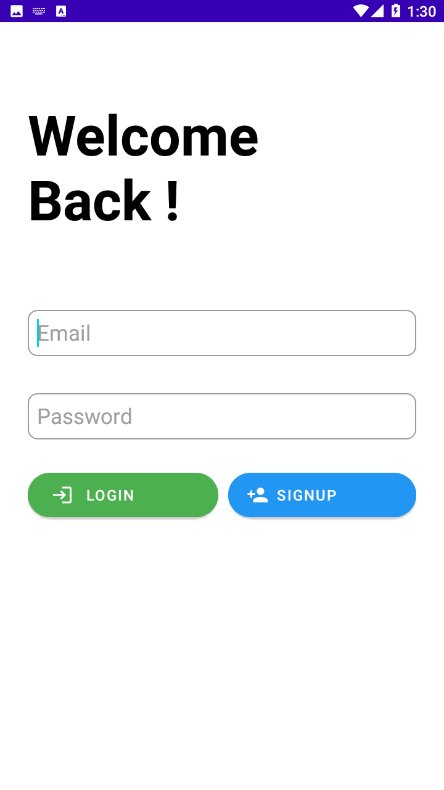
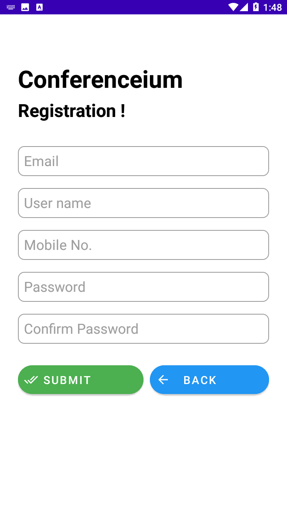
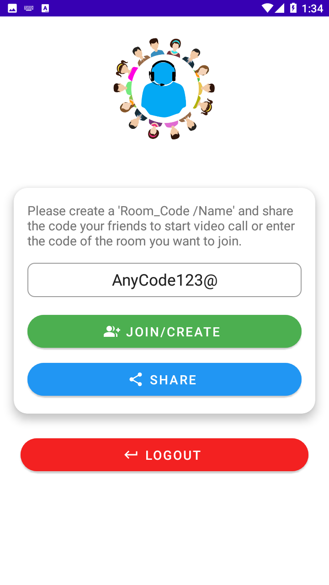
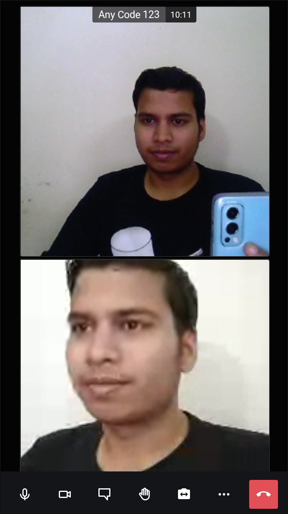
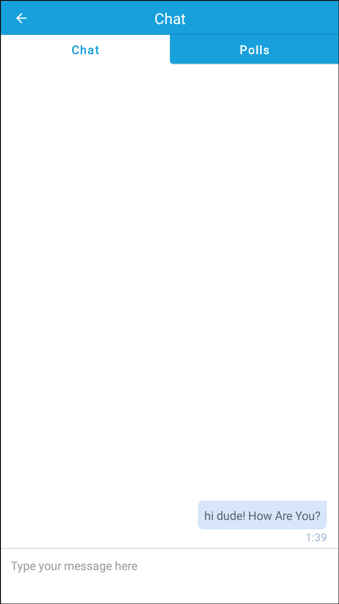
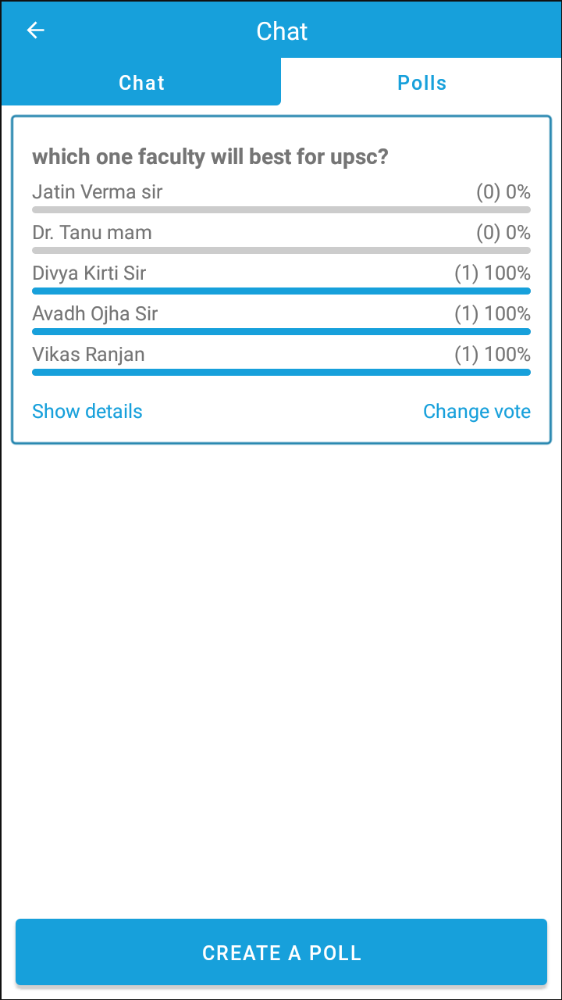
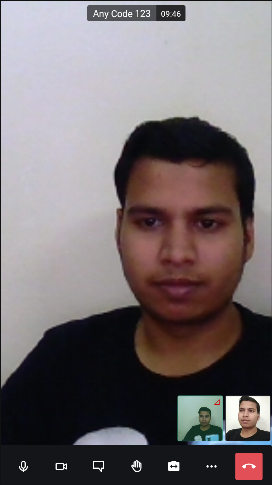
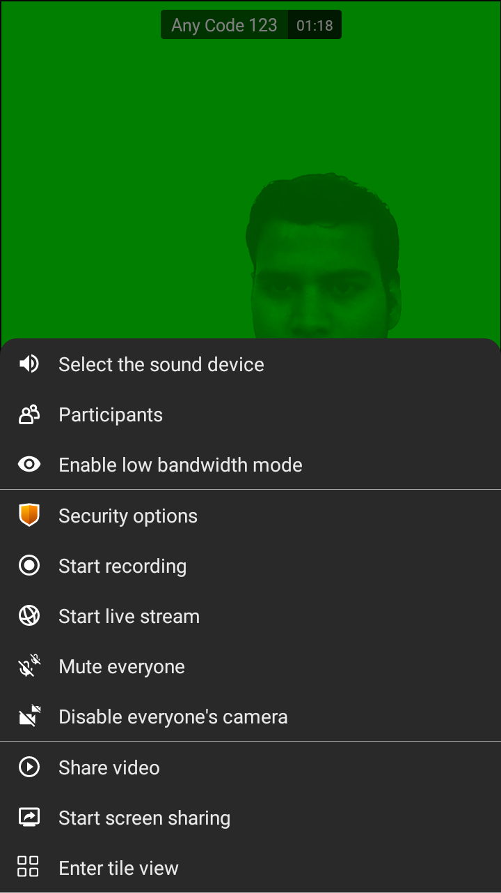
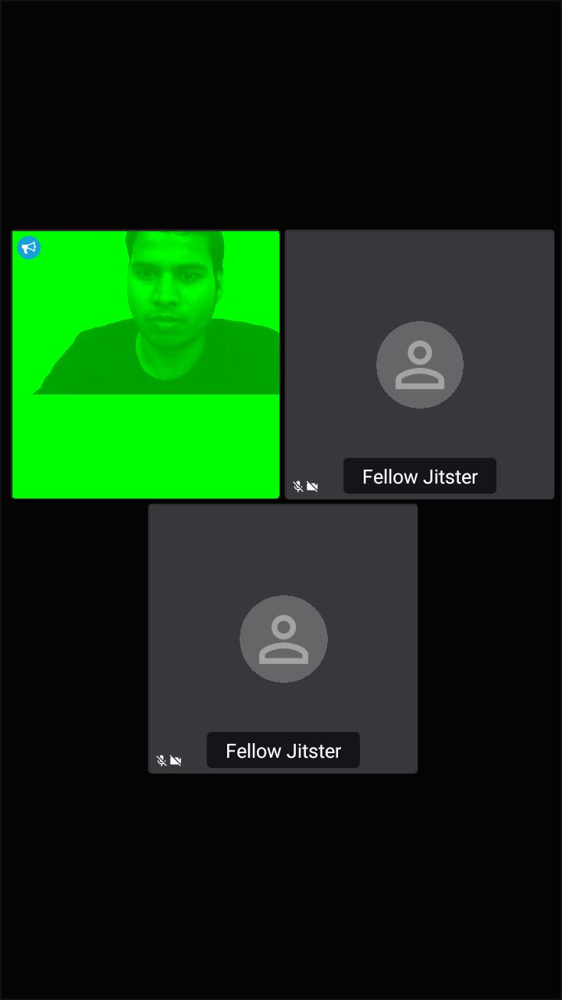

# Conference-Call-Android-App

A premium Android video conferencing application built with Java on Android, powered by the Jitsi Meet SDK and Firebase Authentication/Firestore. This project provides a clean user experience for secure login/signup, creating or joining video meetings using a room code, and sharing meeting invites.

This repo contains two project variants:
- `Conference-Call-Android-App-withCredentials` — includes Firebase authentication and Firestore integration
- `Conference-Call-Android-App-withoutCredentials` — demo version without Firebase credentials

## Project Overview

Conferenceium is a real-time video conferencing app designed for:
- Business meetings
- Online classes
- Family and friend calls
- Team collaboration

It allows users to join meetings quickly by entering a room name or code and start a secure video session without complicated setup.

## Features

- User registration and login
- Firebase-powered authentication
- Profile data storage in Firestore
- Splash screen and onboarding feel
- Room-based video conferencing using Jitsi
- Join meeting by entering room code
- Share meeting invite via messaging apps
- Simple, clean UI for Android devices
- Logout and app close flow

## Tech Stack

- Android Java
- AndroidX / Material Components
- Firebase Authentication
- Firebase Firestore
- Jitsi Meet SDK
- Gradle build system

## App Screenshots

### App Icon

### Login, Signup, Splash and App Screens

## APK

A ready-to-install APK is available here:
- `apk_file/app-release.apk`

## Setup Instructions

1. Open Android Studio.
2. Import the project folder `Conference-Call-Android-App-withCredentials/Conference-Call-Android-App` or `Conference-Call-Android-App-withoutCredentials`.
3. Let Gradle sync complete.
4. Connect an Android device or start an emulator.
5. Run the app.

### Firebase Setup (for credentials version)

If using the credentials-based version:
- Add your `google-services.json` file in `app/`
- Enable Firebase Authentication and Firestore
- Configure the project in Firebase Console

## Notes

- The project demonstrates a working video conferencing app architecture using Jitsi.
- The without-credentials version is useful for demo/testing purposes.
- The credentials version is suitable for real app deployment with user login and profile management.

## Conclusion

This project is a complete Android conferencing solution that highlights real-world mobile app features such as user authentication, meeting join flow, sharing, and video calling integration. It is suitable for showcasing technical capability in interviews, portfolio presentations, and academic demos.

---

If you want, I can also create a more professional version of this README with:
- badges
- installation steps for each variant
- architecture diagram
- demo video section
- project demo summary for interviewers
